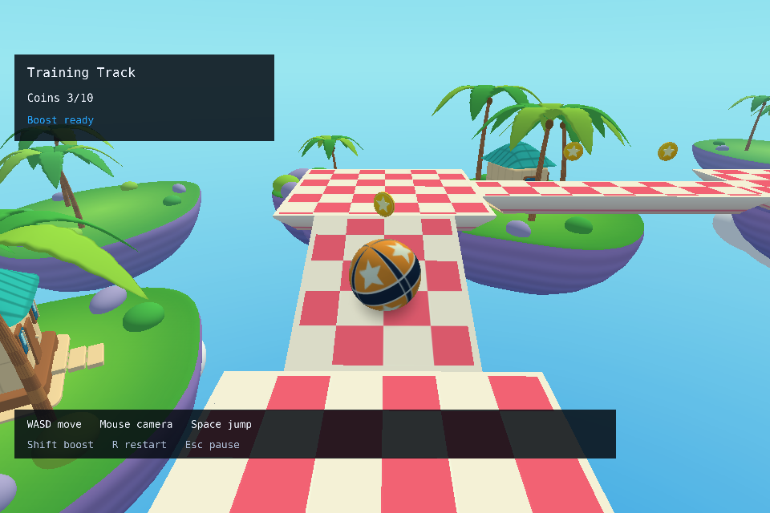
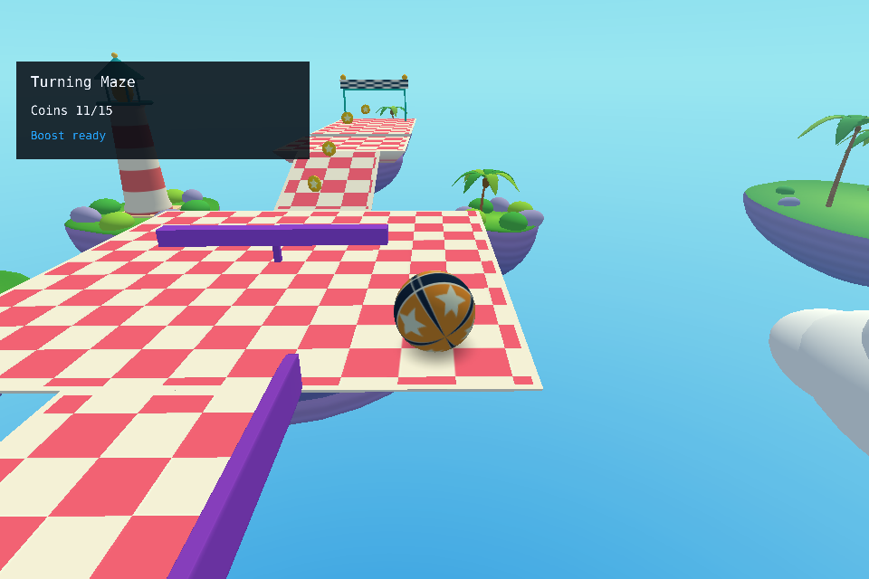
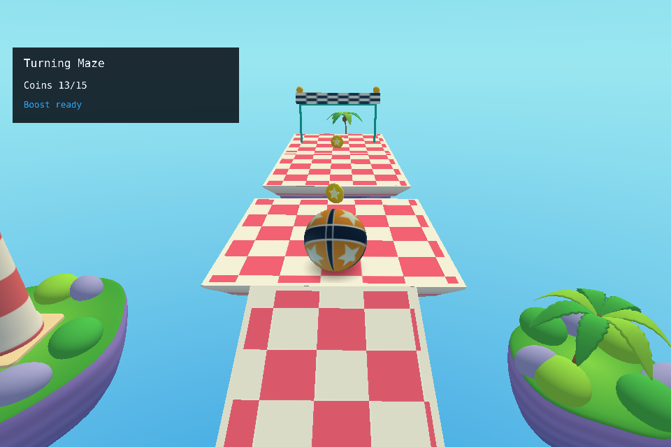

<div align="center">

# Ball Adventure

**Кати шар. Собирай монеты. Покоряй воздушные острова.**

3D-платформер на собственном [Simple 3D Engine](https://github.com/alken1t15/simple-3d-engine).
Пять уровней, девять скинов и путь к финальному испытанию Sky Storm.

[](https://github.com/alken1t15/simple-platformer/actions/workflows/ci.yml)
[](global.json)
[](#запуск)
[](LICENSE)

[Запуск](#запуск) · [Управление](#управление) · [Уровни](#пять-уровней--одно-приключение) · [Документация](#для-команды)



*Реальный кадр игры с оформлением `--visual`.*

</div>

## Пять уровней — одно приключение

Начни с безопасных дорожек, освой прыжки и ускорение, а затем пройди лабиринт,
вращающиеся препятствия и платформы на разной высоте. Монеты не обязательны для
финиша, но именно они помогают заработать звёзды и открыть награды.

| Локация | Что ждёт игрока |
|---|---|
| **Training Track** | Первые мосты, наклоны и прыжки |
| **Turning Maze** | Развилка с бонусным тупиком, повороты и вращающаяся балка |
| **Jump Circuit** | Смертельные стены, которые нужно перепрыгивать |
| **Island Circuit** | Изогнутые мосты, подъём и финальный прыжок |
| **Sky Storm** | Поднимающаяся петля, путепровод и рассыпающиеся опоры |

Первые четыре уровня доступны сразу. **Sky Storm открывается за 12 звёзд** на них.
Всего в пяти локациях **66 монет** и **15 звёзд**.

### Собирай и открывай

- **1 звезда** — доберись до финиша; **2** — собери хотя бы половину монет; **3** — собери все.
- Лучший результат каждого уровня сохраняется между запусками. Повторная попытка не снижает рекорд.
- Шесть скинов открыты сразу; **Neon circuit**, **Aurora** и **Golden champion** — награды за 6, 9 и 15 звёзд.
- Меню позволяет выбирать уровни и скины, менять громкость, разрешение и полноэкранный режим.
- В режиме `--visual` главное меню компактно расположено слева; меню и HUD используют
  тёмно-бирюзовые панели, светлый текст и мятное выделение выбранной кнопки.
- **Settings → Music** переключает исходную музыку и Exploration Theme. Прежний трек выбран по умолчанию;
  новый — музыка [Cleyton Kauffman](https://opengameart.org/content/exploration-theme) под CC0.

[Правила прогресса и расположение сохранения](docs/progression.md) · [Содержание уровней](docs/extra-levels.md)

## Кадры из игры

| Вращающаяся балка в Turning Maze | Прыжок к финишной платформе |
|:---:|:---:|
|  |  |

Скриншоты сняты через настоящий renderer в режиме `--visual` на Linux/Xvfb/Mesa.
Обычный запуск сохраняет исходное оформление; уровни и правила игры в обоих режимах одинаковы.
[Версия и происхождение снимков](docs/images/README.md).

## Запуск

### 1. Собери проект

Нужны **Git**, **.NET 10 SDK** согласно [global.json](global.json), графический сеанс
и **OpenGL 3.3**. Для первого восстановления пакетов нужен доступ к NuGet.
Один .NET Runtime и SDK 8/9 не заменяют SDK 10 для сборки.

```sh
git clone --recurse-submodules https://github.com/alken1t15/simple-platformer.git
cd simple-platformer
git submodule update --init --recursive
dotnet restore Platformer.sln
dotnet build Platformer.sln -c Release --no-restore
```

На Debian/Ubuntu/Mint для звука нужна `libopenal1`. При отсутствии устройства игра
может перейти в silent mode с диагностикой. [Подробнее о звуке](docs/game-audio.md).

### 2. Начни приключение

Для оформления со скриншотов:

```sh
dotnet run --project src/Platformer.App -c Release --no-build -- --visual
```

Для исходного оформления:

```sh
dotnet run --project src/Platformer.App -c Release --no-build
```

Оба варианта открывают главное меню. `dotnet run` связан с терминалом: Ctrl+C завершает игру.

**Отдельный Linux-запуск после сборки:**

```sh
bash scripts/Play.sh
```

Без аргументов лаунчер использует исходное оформление; `bash scripts/Play.sh --visual`
включает оформление со скриншотов. Нужны .NET 10 Runtime в `PATH`, `setsid` из util-linux и графический сеанс.
Ctrl+C и закрытие исходного терминала не завершают игру; логи сохраняются в `artifacts/run/`.
Лаунчер не выполняет сборку. Закрывай игру через Exit или системную кнопку окна.

**Linux-ярлык с фирменным значком** — после сборки:

```sh
python3 scripts/install_desktop.py            # Ball Adventure в меню приложений
python3 scripts/install_desktop.py --desktop  # дополнительно на рабочем столе
```

Ярлык запускает `--visual` без терминального окна. `sudo` не нужен; при переносе
клона установи его заново. [Инструкция и ограничения](docs/desktop-launcher.md).

**Windows / WSL:** [пошаговая инструкция](docs/windows-wsl.md). Доступны сборка в WSL,
прямой Windows-запуск и локальная OpenAL Soft для звука. При слишком резкой камере
через WSLg сравни с прямым Windows-запуском той же сборки.
Общий [значок ICO](assets/branding/ball-adventure.ico) можно выбрать в свойствах Windows-ярлыка.

## Управление

| Действие | Клавиши |
|---|---|
| Катить шар относительно камеры | **W A S D** |
| Прыгнуть; повторять прыжок после приземления | **Space**; удерживать для автопрыжка |
| Кратковременно ускориться | **Shift** |
| Перезапустить уровень | **R** |
| Повернуть камеру | **Мышь** |
| Пауза / продолжить / назад | **Escape** |
| Выбрать пункт меню | **↑ / ↓**, **Tab / Shift+Tab** |
| Активировать пункт | **Enter / Space / клик** |

Карточка уровня сразу запускает его, карточка открытого скина — применяет выбор.
Потеря фокуса ставит игру на паузу; продолжение требует Continue. Выход из попытки
в главное меню запрашивает подтверждение, **Cancel выбран по умолчанию**.

Размер окна меняется через **Settings → Resolution → Apply resolution**; растягивание
за края отключено. **Display → Fullscreen → Apply** использует текущее разрешение монитора.
[Меню, звук и ограничения оконных режимов](docs/menu.md#window-size).

## Для команды

Игра построена на **C# / .NET 10**. Логика, ввод и представление разделены:

```text
Platformer.Core   физика, уровни, монеты, препятствия и сеанс — без окна и GPU
Platformer.App    меню, камера, прогресс, звук и адаптация к API движка
Platformer.Tests CPU-регрессии и интеграционные проверки; графика проверяется отдельно
```

Движок закреплён в `external/engine` на `04cd6fd441e7974060d5a47b69e49c3598bb047d`.
Его изменения проходят отдельный upstream PR и интеграцию точного gitlink:
[порядок engine-first](docs/engine-integration.md#engine-first).

| Начать работу | Разобраться в проекте |
|---|---|
| [Участие и команды](CONTRIBUTING.md) | [Архитектура](docs/architecture.md) · [API](docs/game-api.md) |
| [Команда и роли](docs/team.md) | [Требования](docs/requirements.md) · [Объём и готовность](docs/project-scope.md) |
| [Карта задач и документов](docs/task-guide.md) | [Содержание игры](docs/content-design.md) · [Сценарии приёмки](docs/acceptance.md) |
| [План и зависимости](project_plan.md) · [Календарь](docs/schedule.md) | [Процесс разработки](docs/development-process.md) · [Доска](docs/github-project.md) |
| [Инструкции агентам](AGENTS.md) | [Сторонние компоненты](THIRD_PARTY.md) · [Лицензия MIT](LICENSE) |

### Проверки

```sh
dotnet test Platformer.sln -c Release --no-build
python scripts/check_docs.py
git diff --check
```

Полный цикл restore/build/test/docs: `pwsh -NoProfile -File scripts/Verify.ps1` (PowerShell 7).
Проверенная интеграция пяти уровней включает **340 тестов** и автоматический маршрут
с 66/66 монетами. Это результаты конкретной проверки, а не обещание производительности.
Ручной прогон реального устройства, слышимость, HiDPI и FPS фиксируются отдельно.
[Интеграционный отчёт](docs/integration-qa.md) · [Графика и ввод](docs/input-camera-testing.md).

<details>
<summary>Диагностические режимы и preview</summary>

```sh
# Три кадра главного меню и штатное завершение
dotnet run --project src/Platformer.App -c Release --no-build -- --visual --smoke

# Сценарный preview: Space меняет скин, R сбрасывает, Escape закрывает
dotnet run --project src/Platformer.App -c Release --no-build -- --visual --presenter --skin football --overview --still

# JSON-диагностика ввода и UI
dotnet run --project src/Platformer.App -c Release --no-build -- --trace-input
```

`--play` — явный вариант обычного игрового запуска. `--legacy` показывает старую
интеграционную сцену; `--presenter` — сценарные объекты, а не игровой сеанс.
Любой `--smoke` ограничен тремя кадрами без игрового ввода, ticks и захвата курсора.
Счётчик `Rendered frames` выводится в диагностических режимах; обычный выход его не печатает.
Smoke не создаёт AudioDevice и не подтверждает слышимость.

</details>
