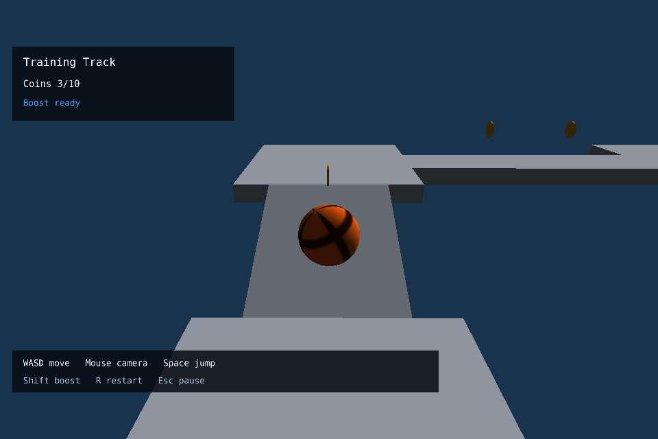
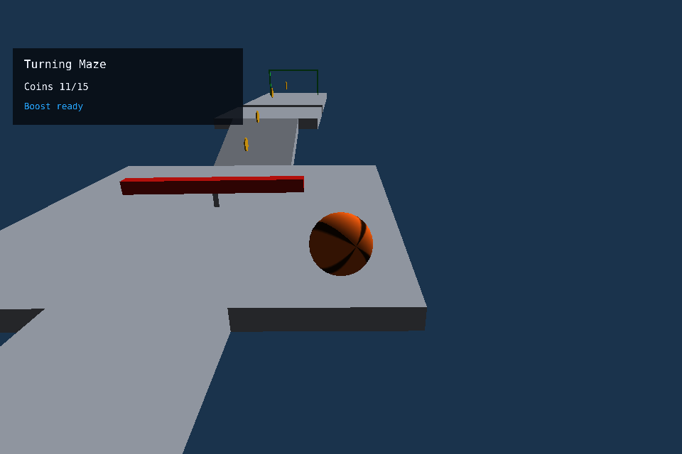
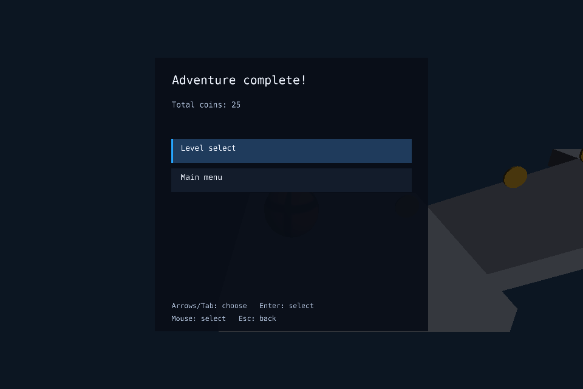

# Проверка интеграции #6/#7/#8 — Linux, 07.11.2026

Engine: принятый [upstream PR54](https://github.com/alken1t15/simple-3d-engine/pull/54),
точный SHA `936b71a7393ef52b7d0d3b277af6b4c287be92c6`,
[перенос версии в игру PR39](https://github.com/alken1t15/simple-platformer/pull/39).
Среда автоматических проверок: Ubuntu/WSL2 x86_64, .NET SDK10.0.401,
Mesa/software GL, отдельный Xvfb; native Wayland — nested Weston9.

## Маршрут и lifecycle

ProductionRouteTests использует настоящий GameLevels: Training Track → Turning Maze.
Синтетические WASD/mouse yaw/Space проходят InputRouter, fixed runner, GameSession,
LevelFlow, Presenter и AudioCoordinator. Нет телепортации/замены физики/тестовых уровней.
Пройден наклон, мост, прыжки, бонусная ветка и безопасный край арены;
первый финиш ведёт через MenuController Next ко второй локации, последний — к GameComplete.
Итог 10+15=25 монет, без повторных CoinCollected/LevelCompleted и второго music loop.
Отдельно проверяются прямой выбор level2, пауза/Restart, падение/Failed/R,
новый SessionId, исходная поза балки/шара, нулевой счёт и остановленные старые effects.

Тот же входной маршрут повторён в настоящем Engine.Run: 3258 входных кадров,
GameComplete/25 монет, публичный OpenAL null с реальными WAV и voices.
Ресурсы найдены и скопированы в output. Это автоматическое прохождение,
не ручная независимая QA, не измерение FPS и не подтверждение слышимости.

## Визуальная сверка

Снимки настоящего renderer просмотрены: шар со скином orange, монеты, наклон/мост,
финиш, красная вращающаяся балка и её ось, HUD и общий результат.
Transform опасности берётся из того же HazardPose, что collider; CPU-регрессии
проверяют совпадение центра, ориентации и размеров на движении/паузе/Restart.
Второй скин и scripted preview сохраняют существующие проверки.

## Ввод, масштаб и границы проверки

Native X11-драйвер проверяет обе записи LevelSelect, прямой level2, клавиши/фронты,
mouse yaw/pitch, capture/rearm, паузу, Settings/Back, Restart, focus loss/gain,
resize hit-test, громкость/mute и скин. Обычный ручной mouse/WM Alt-Tab/resize-протокол
записан Николаем [в PR37](https://github.com/alken1t15/simple-platformer/pull/37#issuecomment-6706397263)
со слов пользователя; он не выдаётся за новый ручной прогон Codex.

Native Wayland compositor имеет output scale2; настоящее приложение получило
client1024×768/framebuffer2048×1536. Сдвиг указателя на 40 физических пикселей дал
20 логических, hover/click Levels/Settings/Play совпали с logical bounds;
capture и Escape→Paused/Normal прошли. Это не synthetic viewport scale:
буфер выделен GLFW/Wayland. Отдельный GPU-тест движка проверяет реальные пиксели overlay
при framebuffer/client=2. Скрипт upstream — `scripts/check_hidpi_wayland.sh`.

Физический HiDPI-монитор, полный ручной маршрут, слышимость и FPS этим не подтверждены.
Окончательное оформление контента #21 и независимые QA/сдача #9–13 остаются отдельными задачами.
Правила и критерии этих задач не изменены.

## Расширение 08.11.2026

Исторический renderer-протокол двух исходных уровней выше сохранён. Теперь каталог
дополнен Jump Circuit/Island Circuit, CPU-маршрут всех четырёх уровней проверен
в обоих режимах с 46/46 монетами; [новый объём и ограничения](extra-levels.md).

09.11.2026 CPU-маршрут расширен до пяти уровней с 66/66 монетами в обоих оформлениях,
включая открытие финала за 12 звёзд, путепровод и рассыпающиеся опоры.
[Правила, новые проверки и ограничения](progression.md). Прежний renderer-протокол выше относится к исходным двум локациям.
