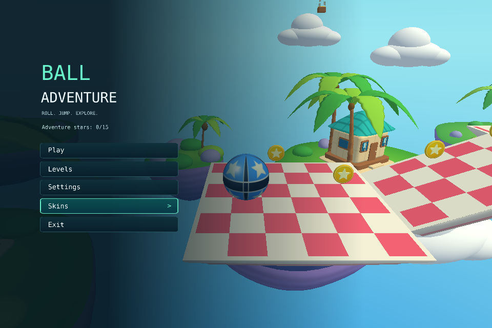

# Меню и HUD (#19): оконная интеграция

MenuController, MenuView, адаптивная раскладка и HudModel подключены к GameplayHost (#6)
и публичному overlay движка. Обычный запуск и `--play` открывают графический Main Menu;
это тот же Engine/Scene lifecycle, что и игра. Движок закреплён на принятом
`04cd6fd441e7974060d5a47b69e49c3598bb047d`, upstream
[PR #57](https://github.com/alken1t15/simple-3d-engine/pull/57) добавил fullscreen в desktop mode;
PR #56 — запрет растягивания за края;
PR #55 — ограничения окна и смену размера.
Ранее ClientSize принят через engine PR #54 / игровой
[PR #39](https://github.com/alken1t15/simple-platformer/pull/39).

UI/HUD работает с настоящими LevelFlow, GameSession и Presenter. Каталог поставки
содержит Training Track и Turning Maze; WAV/AudioCoordinator подключены.
Слышимый звук и полная приёмка контента ещё требуют #21/QA. Авторские CPU-тесты/снимки с двумя контролируемыми уровнями
не подменяют настоящую Turning Maze. [Объём](project-scope.md), [контракт](app-engine-contract-v1.md#app).

## Поведение UI

HUD в Playing занимает 336×108 вместо 432×144 в базовой раскладке 1280×720.
Название уровня, монеты и буст сохраняются; размеры текста — 22/18/16 логических
пикселей до масштабирования. Нижняя подсказка управления масштаб не меняет.

### Оформление островов

С `--visual` главное меню располагается слева: крупный заголовок, компактные
кнопки и затемнение, плавно исчезающее к правому краю. Воздушные острова остаются
видны. Settings, Levels, Skins, пауза, подтверждение выхода, результаты и HUD
используют тёмно-бирюзовые панели, светлый текст и мятный фокус. Заблокированные
награды приглушены и содержат условие открытия; фокус дополнительно обозначен
боковой полосой и в главном меню стрелкой.

`MenuController` передаёт визуальный режим в `MenuLayout`; отрисовка и hit-test
используют общие границы. `MenuPanelKind` задаёт назначение панелей, а
`MenuOverlayAdapter` переводит их в изображения `TropicalMenuTheme` перед превью
скинов, звёздами и текстом через публичный overlay. Процедурные RGBA-текстуры
создаются один раз и переиспользуются. Без `--visual` остаются исходные тема и
раскладка диагностического меню.


Автоматическая проверка с настоящим X11-вводом и снимками:

```sh
LIBGL_ALWAYS_SOFTWARE=1 xvfb-run -a python3 scripts/check_gameplay_x11.py --visual --output artifacts/tropical-menu
```

Она проверяет меню, громкость/музыку, fullscreen, hit-test после смены размера,
выбор скина и возврат из игры; слышимость и физическое устройство не подтверждает.

<a id="window-size"></a>

### Разрешение окна

Settings содержит Display: Windowed/Fullscreen и строку Resolution. Клик/Enter
переключает режим или выбирает следующий размер, Left/Right меняет выбранное значение.
Apply resolution применяет режим и размер вместе; переход Back
не применяет его. Current window показывает фактический размер, полученный от ОС,
поэтому асинхронное изменение или коррекция оконным менеджером не скрываются.
Размер относится к клиентской области без рамки, в логических пикселях; на HiDPI
кадровый буфер может быть больше. В Fullscreen используется весь монитор в текущем
desktop video mode без выбора другой частоты. На Full HD-мониторе с масштабом 100%
доступны все 1920×1080: рамка/панель задач не вычитаются. Размер в этом режиме
нативный; отдельное понижение разрешения монитора не реализовано.

Варианты: 800×450, 960×540, 960×640, 1024×576, 1280×720, 1600×900, 1920×1080;
в Windowed видны только помещающиеся в текущие оконные ограничения. В Fullscreen
список содержит полный текущий размер монитора. Перетаскивание краёв и углов
окна отключено: размер выбирается через Resolution → Apply resolution.
Resizable=false запрещает только пользовательский resize; программный SetClientSize
из Apply работает независимо от этого флага и сохраняет ограничения min/max.
Фактический размер ОС также доступен в списке, если соответствует границам.
Начальный размер — 960×640, минимум — 800×450;
если экран меньше минимума, используются размеры доступной области.
Максимум обычного окна учитывает рабочую область монитора и рамку. При изменении
монитора список обновляется, недопустимый отложенный выбор сбрасывается.
При возврате Windowed восстанавливается выбранный оконный размер и сохранённая позиция,
с ограничением по текущему экрану. На Wayland позицию выбирает compositor;
без известного положения окна для Fullscreen используется основной монитор.
Смена режима не пересоздаёт игру или звук. Потеря фокуса оставляет игру на паузе,
без автоматического Continue. Выбор действует в текущем запуске.

На Wayland backend GLFW не предоставляет положение окна и рабочую область без
панелей compositor: максимум берётся консервативно по наименьшей логической области
подключённых мониторов. Ограничение не гарантирует расположение относительно панелей.
На Windows/X11/macOS используется рабочая область монитора окна.

`MenuController.Window` — CPU-модель `WindowSettings`: список Choices, Selected,
подтверждённый Actual и однократный запрос TakeDisplayRequest (режим и размер вместе).
Program передаёт размеры/режим/оконные границы через Synchronize, затем вызывает
публичный Engine.SetFullscreen и, только в Windowed, Engine.SetClientSize.
Core, LevelFlow, звук и текущий сеанс при выборе размера не пересоздаются.

### Остальные действия

- Все девять состояний используют единственный `LevelFlow.Screen`:
  MainMenu, LevelSelect, Settings, SkinSelect, Playing/HUD, Paused, Failed,
  LevelResult и GameComplete. Меню не создаёт второго GameSession или своей таблицы монет.
- Up/Down/Tab меняют выбор; Shift+Tab (любой Shift) выбирает предыдущий пункт,
  с переходом с первого на последний. Удержание стрелок/Tab повторяет действие после
  350 мс, далее каждые 80 мс; Left/Right так же меняют громкость и выбранные значения.
  Enter/Space активируют элемент только по новому нажатию, Escape/R не повторяются.
  Повтор сбрасывается при отпускании, смене экрана и потере фокуса; после возврата
  удержания требуют отпускания и нового нажатия. Время задаётся кадром App,
  системный autorepeat не используется; после зависания нет пачки действий за один кадр.
  Mouse hover следует за движением
  указателя; неподвижная мышь не отменяет клавиатурный выбор. Клик имеет приоритет над
  Enter в том же кадре и выполняет ровно одно действие. Есть normal/focus/hover/pressed данные.
- Settings меняет громкость шагом 5% с клавиатуры либо кликом по шкале, отображает
  процент и mute. Callback получает эффективную громкость при создании контроллера,
  до первого Start, и сразу после изменения. Mute сохраняет предпочитаемую громкость.
  При Mute: ON подпись и шкала показывают 0%, сохранённое значение возвращается по Unmute.
  Изменение шкалы выше нуля (мышью или Left/Right) автоматически выключает mute и
  применяет новую громкость. Нажатие Left/клик на нуле при уже включённом mute не
  меняет шкалу и не уничтожает сохранённое предпочтение.
  Легенда группирует ввод по действию: Up/Down — выбор, Tab/Shift+Tab — следующий/предыдущий,
  Enter/Space/Mouse click — активация; Escape/Exit подписаны по текущему экрану.
- Settings / Music выбирает Original или Exploration Theme (Left/Right, Enter/Space или клик).
  Original остаётся по умолчанию; выбор не требует Apply и сохраняется в текущем процессе.
  В Settings из паузы новый трек начинает звучать только после Continue; mute и громкость
  действуют на оба трека одинаково. [Источник и lifecycle](game-audio.md).
- SkinSelect показывает девять текстурных изображений шарика из материалов `GameSkins`; активация карточки
  мышью/Enter/Space сразу применяет открытый скин. Закрытые карточки показывают требование рейтинга. Дополнительной кнопки Select нет, Back сохраняет выбор.
  Start/Restart/Next используют выбранный скин через существующий Presenter.
- HUD читает имя уровня, CoinCount/число монет уровня и boost timers из принятого snapshot.
  Active имеет приоритет над cooldown; время отображается с точкой. Подсказка управления
  показывается первые 8 секунд симуляции: это параметр оформления этой реализации.
- LevelSelect строит карточки по переданному каталогу. Имена `level1`/`level2` — Training Track /
  Turning Maze; тесты с двумя уровнями не означают, что игровые данные level2 уже поставлены.
  Недостающая локация не заменяется копией level1.

## Переходы

| Экран / действие | Результат |
|---|---|
| MainMenu / Play | Start первого уровня каталога, новый маршрут |
| MainMenu / Levels, Settings, Skins | Соответствующее подменю |
| MainMenu / Escape | Без действия; закрывает только Exit |
| LevelSelect / активация карточки | Немедленный Start выбранного уровня, без отдельной кнопки Start |
| LevelSelect / Back или Escape | Возврат в MainMenu, Failed либо GameComplete, откуда открыли выбор |
| Settings / Back или Escape | Возврат в MainMenu либо Paused; громкость применяется сразу, режим/размер — только через Apply |
| SkinSelect / активация карточки, Back | Сразу применить скин; Back возвращает в MainMenu |
| Playing / Escape, R | Pause либо Restart; меню не выполняет Step |
| Paused / Continue или Escape | Continue с очисткой отложенного ввода |
| Paused / Restart, Settings | Соответствующий переход; Settings сохраняет audio pause |
| Paused / MainMenu | Подтверждение завершения текущей попытки |
| Failed / Retry или R | Новая попытка текущего уровня |
| Failed / LevelSelect | Выбор уровня; Back сохраняет прежнее поражение |
| Failed / MainMenu или Escape | Подтверждение завершения текущей попытки |
| LevelResult / Next | Следующий уровень либо GameComplete после последнего |
| LevelResult / Retry | Повтор текущего уровня, без повторного начисления монет |
| LevelResult / MainMenu или Escape | Подтверждение завершения текущей попытки |
| GameComplete / LevelSelect | Выбрать новый маршрут; Back сохраняет итог прежнего |
| GameComplete / MainMenu или Escape | Вернуться в главное меню |
| Потеря фокуса в Playing | Paused; активация окна сама не вызывает Continue |

`OpenLevelSelect`, `OpenSettings`, `OpenSkins`, `Back` добавлены в LevelFlow.
Перед выходом из активного сеанса появляется `Leave this run?` с предупреждением
о потере прогресса. По умолчанию выбран Cancel; Enter или Escape отменяет выход,
R внутри подтверждения не перезапускает уровень. Отмена сохраняет сеанс и экран;
Leave to main menu завершает попытку. При открытии/отмене сбрасывается отложенный ввод,
даже если `AppScreen` не изменился. После подтверждения последний вид уровня остаётся
неподвижным фоном меню, включая уже собранные монеты. Это не сохранённая попытка:
Play или карточка уровня начинает новую игру. Из GameComplete подтверждение не требуется.

Недопустимые переходы отклоняются до reset callbacks. Переходы в подменю и обратно
очищают отложенный ввод, сохраняя сеанс и audio pause. Остальные callbacks и правила
подготовки/ошибок — [GameSession/LevelFlow](game-session.md#подключение-адаптеров).

## Связь с host, overlay и аудио

Program один раз читает engine.Input в onUpdate и NativeInputAdapter переносит его
в AppInputSnapshot. GameplayFrameRunner сначала обрабатывает R/Escape/focus, затем
mouse look и фиксированные ticks. MenuController получает уже маршрутизированный
InputFrame; временные клавиатурные переходы прежнего стенда #6 удалены.
В Playing удержание Space передаётся отдельно как `JumpHeld`: каждый физический tick
запрашивает прыжок, а Core разрешает его только на земле. После приземления шар снова
прыгает, пока Space удерживается. В меню Space активирует пункт только новым нажатием;
после перехода/возврата фокуса удержанная клавиша требует отпускания и нового нажатия.

Flow.Screen единственный источник состояния. После Menu.Handle и успешных ticks
host синхронизирует runner с экраном, выполняет reset/rearm, обновляет Camera/Scene
и строит MenuView. Start/Restart/Next сбрасывают камеру, Continue сохраняет ориентацию.
Terminal tick запрашивает RequestClear: catch-up прекращается после него.

На переходе из Captured в меню первая Normal позиция указателя задаёт новую базу
через ResetPointerPosition, поэтому изменение системы координат не переключает выбор
с Continue на другую кнопку. Последующее движение либо новый клик работает нормально.
Потеря фокуса ставит паузу; автоматического Continue нет.

MenuOverlayAdapter переводит панели/текст MenuView в immutable OverlayFrame и Program
вызывает SetOverlay на потоке Create. Размер берётся из ClientSize.Width/Height
(**logical client area**); те же размеры и Bounds используются для hit-test и рисования.
FramebufferSize в UI-геометрию не подставляется. Нулевой размер даёт пустой UI-кадр.
Единственная композиция рисуется поверх 3D; отдельного HUD у Presenter нет.

Program создаёт один AudioDevice до MenuController. Callback с первого меню задаёт
MasterVolume; volume/mute действуют сразу на устройство, выбранная громкость сохраняется
в UserSettings. В smoke устройство не создаётся. Игровые WAV, голоса, pause/resume
AudioCoordinator и проверка слышимости остаются в #21; отсутствие клипов не считается
выполненным звуковым сопровождением. AudioDevice освобождается при завершении приложения.

UI использует английский ASCII согласно атласу движка; скины представлены изображениями настоящих материалов GameSkins
в сетке 2x3. Проекция/матрицы/GL остаются у движка.

## Проверки и оставшаяся передача

24 новых авторских CPU-теста в MenuControllerTests, MenuLayoutTests, HudModelTests и
LevelFlowMenuTests проверяют все девять состояний, реальные Session/Presenter,
Retry/Next/прямой level2 без двойного счёта, начальную громкость/mute, скин,
приоритет mouse+Enter, удержания через InputRouter, фокус, сохранение audio pause,
отклонение неверных переходов и ошибки reset callback.
Раскладка проверяется на 1280×720, 640×480, 320×200, 1920×400, 400×1200;
клик после resize и положение slider используют выданную геометрию.
Отдельная регрессия воспроизводила ложное движение неподвижной мыши после смены экрана:
позиция теперь сохраняется отдельно от hover, поэтому Enter сохраняет клавиатурный выбор.

Для полного закрытия #19 ещё требуются:

- данные Turning Maze из раннего PR #21, игровые WAV/AudioCoordinator и слышимый звук;
- ручная Linux-проверка mouse/keyboard/focus/resize и всех доступных экранов;
- учёт ограничения native HiDPI, применимое ревью/CI и принятие игровой интеграции.

Оконный прогон и снимки описаны в [input-camera-testing.md](input-camera-testing.md).
CPU-части #6/#19 проверяются совместно; данные результатов в специальных визуальных
fixtures нужны для проверки UI, а не для приёмки прохождения двух игровых локаций.

09.11.2026 по утверждённому поручению добавлены [рейтинг, постоянный прогресс, наградные скины и финал с рассыпающимися платформами](progression.md). Первые четыре уровня доступны сразу, Sky Storm открывается за 12 звёзд.
