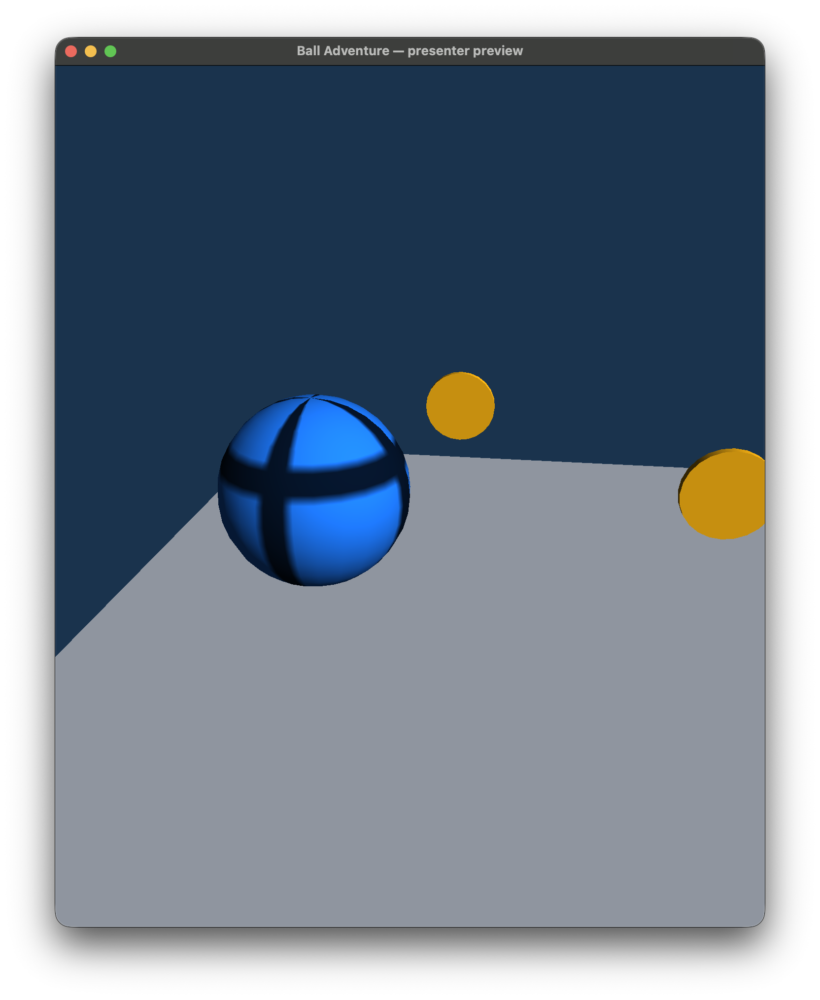
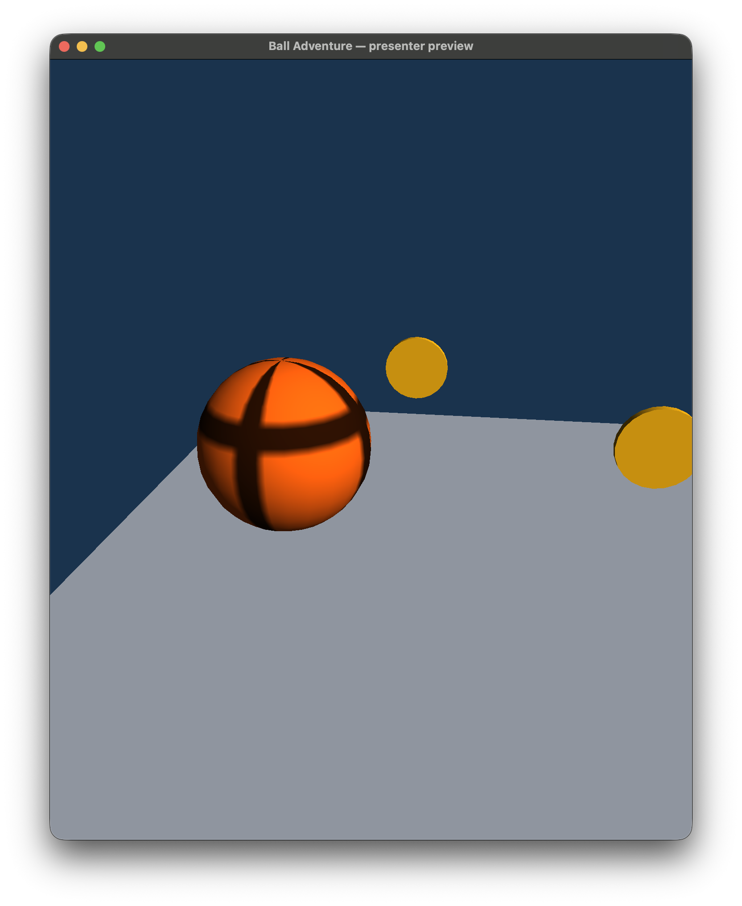

# 3D-представление и скины — задача #7

`GameScenePresenter` в App создаёт Scene через публичные `MeshData`, `MaterialData`,
`TextureData`, `SceneObject` и `Transform`. Он читает `LevelDefinition`/`SessionSnapshot`,
не меняет физику и не содержит ввода, камеры, меню, аудио или HUD. Последний принадлежит #19.

## Объекты и ресурсы

- Шар: UV-сфера радиуса 1, 24 сегмента × 16 колец, 425 вершин и 720 треугольников
  без вырожденных треугольников на полюсах. Нормали направлены наружу, шов UV дублируется
  при совпадающих позициях/нормалях. Масштаб экземпляра равен `snapshot.Ball.Radius`
- Дорожки и стены: один куб с `Position = Bounds.Center`,
  `Rotation = Bounds.Orientation`, `Scale = 2 * Bounds.HalfExtents`.
  Наклон не заменяется ступенями. CPU-тест сравнивает все восемь вершин каждого OBB с рендер-матрицей
- Монеты: золотой короткий цилиндр по Z, общий меш целиком внутри сферы триггера;
  положение и масштаб читаются из определения монеты
- Финиш: зелёная рамка из двух стоек и перекладины, ориентированная по Finish.
  Локальный проём лежит в X/Y, его нормаль — local Z. В Training Track поворот
  Finish +90° вокруг Y ставит ворота поперёк финальной прямой, вдоль мировой Y/Z.
  Сплошной стены или физического коллайдера рамка не добавляет
- Опасность: красный брус с transform строго из `snapshot.Hazards[].Bounds`.
  Узкая ось возле pivot декоративная. Presenter не вычисляет вращение/столкновения из #20

`GameMeshes` кеширует три immutable CPU-меша на процесс. `GameSkins.All` содержит
`classic-blue` и `orange`: разные базовые цвета и одну общую процедурную RGBA-текстуру
64×32 с тёмными меридианами/асимметричным поясом. Файлы изображений для запуска не нужны.
Смена скина заменяет Material, не Radius/Mass/Collider. Объекты монет при сборе удаляются
из Scene, но сохраняются в словаре и повторно добавляются при Restart без пересоздания.
Смена SessionId сбрасывает видимое вращение; повторный Apply того же tick его не накапливает.
Меши и текстуры не создаются в Apply или Restart; их GPU-кешем/освобождением владеет Engine.
CPU-проверка ссылок не является измерением памяти GPU.

## Подключение к сеансу и UI

Общие DTO `SessionSnapshot`, `SessionPhase` и `HazardPose` реализованы в Core по v1,
чтобы Presenter и будущие GameSession/HUD читали один тип. Это не реализация Step,
сбора монет, переходов или событий из #8. Snapshot копирует коллекции, сортирует ID ordinal,
проверяет численные данные и выдаёт read-only списки. Не следует заводить второй тип snapshot в #8.

```csharp
var presenter = new GameScenePresenter(level);
presenter.Apply(snapshot, GameSkins.Get("classic-blue"));
// engine.Run(presenter.Scene, camera, onUpdate)
// после успешного session.Step: presenter.Apply(session.Snapshot, selectedSkin, session.LastPath)
```

Сначала нужен Apply с исходным snapshot, содержащим позу каждой опасности уровня;
до него позы опасностей в Scene не инициализированы. ID уровня/монет/опасностей проверяются,
неверный snapshot отклоняется до изменения Scene. Один Presenter соответствует одному LevelDefinition;
Restart использует тот же экземпляр, Next создаёт новый. Camera и HUD передаются/рисуются их владельцами.

Качение — только видимый поворот. Движение проецируется на касательную к GroundNormal;
ось равна `Cross(normal, displacement)`, угол — длина касательного пути / радиус.
Отдельное вертикальное смещение не создаёт качения. При контакте сохраняется видимая
угловая скорость `Cross(normal, velocity) / radius`; в полёте шар продолжает вращаться
с этой скоростью по времени `SimulationSeconds`. Вращение камеры и управление в воздухе
не обнуляют эту скорость. Прыжок с места без предшествующего вращения сам его не создаёт.
Приземление обновляет скорость от контакта; SessionId/Restart сбрасывают её, повторный
Apply одного tick/пауза не накапливают угол. Время snapshot не убывает и неизменно внутри tick;
ошибочное время отклоняется до изменения Scene. Это визуальная инерция, не изменение физики/collider.
Без пути двухпараметрический Apply использует перемещение между соседними показанными snapshot.
Это приближение: повороты пути между пропущенными ticks восстановить по двум позициям нельзя.

Для учёта ломаной доступен overload:

```csharp
presenter.Apply(snapshot, skin, ballStepResult.Path);
```

Путь должен непрерывно покрывать [0,1], начинаться в предыдущей позиции и заканчиваться
в текущей. При catch-up можно применять каждый завершённый tick по очереди или передавать
объединённый путь с перенормированными долями. Нормаль берётся из текущего BallState;
на переходах опоры это визуальное приближение, а не независимая контактная симуляция.
CPU-тест передаёт настоящий `BallSimulator.Step(...).Path` при подъёме Training Track.
Интеграция #6/#8 должна выбрать этот overload там, где ей доступен путь; основной API v1 сохранён.
GameSession.LastPath сохраняет путь успешного tick, а LevelFlow передаёт его в этот overload
после каждого Step. При Start/Restart начальный Apply сбрасывает поворот по новому SessionId.

## Проверка вручную

```sh
dotnet run --project src/Platformer.App -c Release --no-build -- --presenter
dotnet run --project src/Platformer.App -c Release --no-build -- --presenter --skin orange --still
dotnet run --project src/Platformer.App -c Release --no-build -- --presenter --overview
dotnet run --project src/Platformer.App -c Release --no-build -- --presenter --smoke
```

Это отдельный контрактный preview со сценарными snapshot, не управляемая игра:
шар движется на старте, после 120 обновлений скрывается одна монета, на 360 выполняется reset.
Space переключает скин, R сбрасывает preview, Escape закрывает окно. `--still` фиксирует
позу для снимка, `--overview` показывает маршрут и тестовый вращающийся брус на площадке.
Этот брус добавлен только в preview и не меняет Training Track.
Скорость сценария зависит от числа кадров и не заменяет FixedStepRunner из #6.

Проверяющему: увидеть поворот узора, переключить Space без изменения положения/размера,
дождаться исчезновения монеты, нажать R и проверить её возврат/сброс поворота.
Сценарий не проверяет управление WASD, поражение или сбор монет настоящим GameSession.

Снимки локального OpenGL-запуска на macOS arm64 (поза `--still`):

| classic-blue | orange |
|---|---|
|  |  |

Linux CI отдельно запускает старый smoke и новый preview с обоими скинами,
а `scripts/capture-presenter.sh` на собственном Xvfb-дисплее сохраняет три PNG/лога
в артефакт `presenter-linux`: classic-blue, orange и overview. Захват выполняется после
трёх показанных кадров, проверяется неодноцветность изображения. Это воспроизводимые
снимки Mesa, а не ручная приёмка на целевом Linux-компьютере или проверка FPS.

CPU-тесты: меши/UV/нормали/winding, transform/OBB, настоящий Path физики,
смена скина, повторный tick, сбор/reset, защита snapshot и переиспользование ресурсов.
Окончательное закрытие #7 ждёт #6 и интеграционной/визуальной проверки полного игрового цикла.


## Проверка реальной интеграции на Linux

Presenter отображает настоящий сеанс обеих production-локаций, включая HazardPose вращающейся балки. Автоматический renderer-маршрут завершён с 25 монетами; снимки и ограничения — [протокол](gameplay-integration.md). Старое описание отдельного preview выше сохраняется для этого режима.
